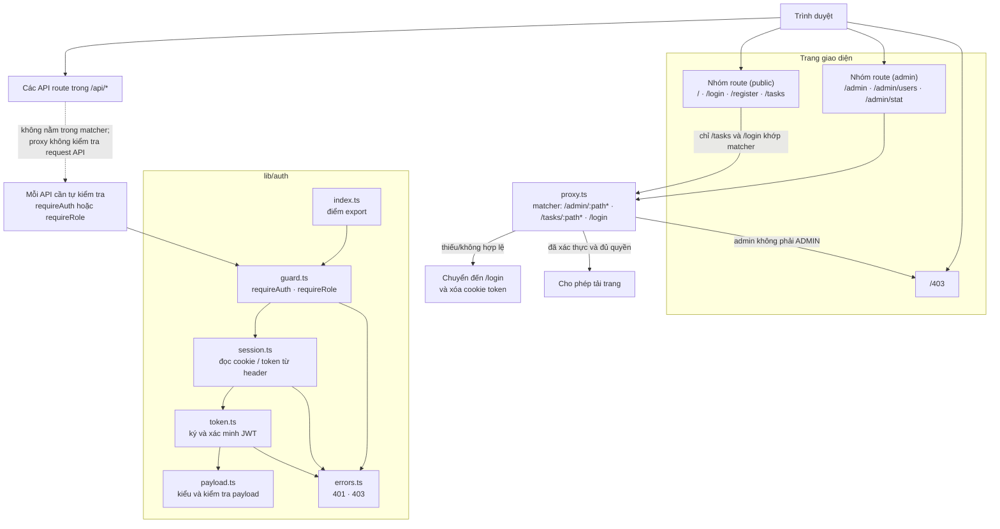
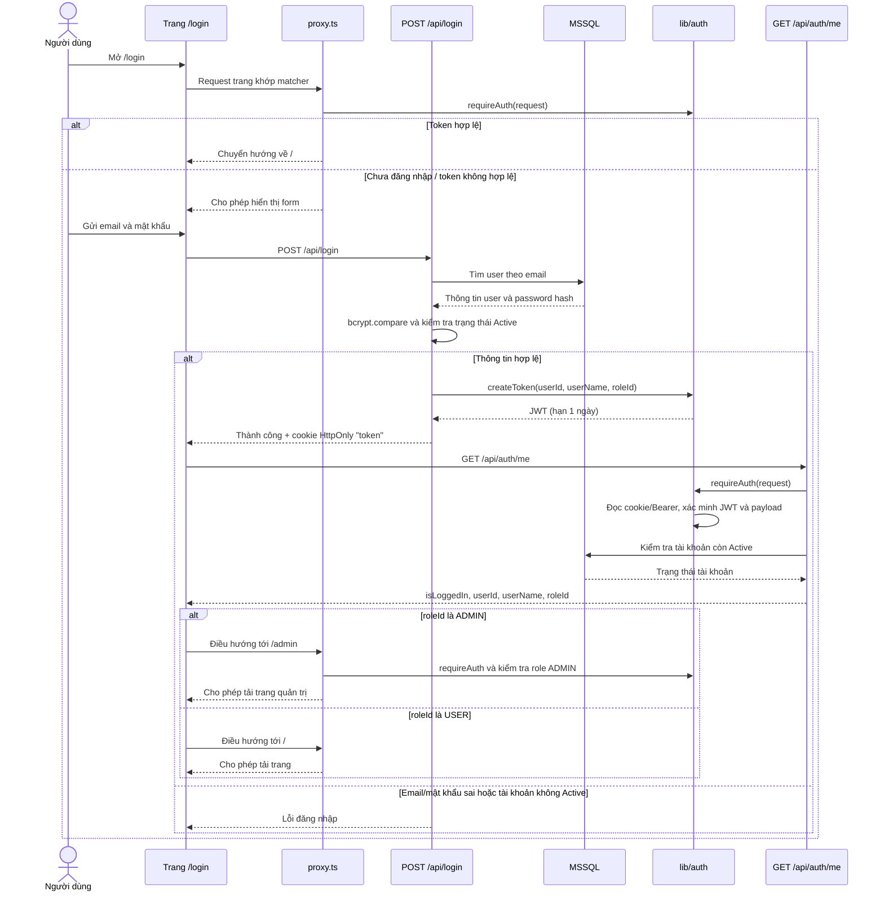

# Kiến trúc ứng dụng và luồng xác thực

Tài liệu này mô tả cấu trúc route hiện tại, các phần của module xác thực và cách request đi qua ứng dụng. Các route group trong ngoặc đơn, như `(public)` và `(admin)`, chỉ dùng để tổ chức mã nguồn; tên group không xuất hiện trong URL và không tự quyết định quyền truy cập.

## Sơ đồ tổng quan



> `app/(public)/tasks` vẫn phục vụ URL `/tasks`, và URL này có trong matcher nên bị `proxy.ts` yêu cầu đăng nhập. `(public)` là tên nhóm thư mục, không phải cam kết rằng mọi trang trong nhóm đều truy cập công khai.

## Luồng đăng nhập



`/api/login` xác thực thông tin đăng nhập rồi đặt cookie; trang đăng nhập tiếp tục gọi `/api/auth/me` để lấy role và chọn URL đích. `/api/auth/me` tự gọi `requireAuth` vì request API không đi qua matcher của proxy.

## Nhóm trang

| Nhóm mã nguồn | URL | Vai trò |
| --- | --- | --- |
| `app/(public)/` | `/` | Trang chủ |
| `app/(public)/login/` | `/login` | Form đăng nhập; proxy chuyển người đã đăng nhập về `/` |
| `app/(public)/register/` | `/register` | Form đăng ký; không nằm trong matcher |
| `app/(public)/tasks/` | `/tasks` | Giao diện công việc; proxy yêu cầu đăng nhập |
| `app/(admin)/admin/` | `/admin`, `/admin/users`, `/admin/stat` | Giao diện quản trị; proxy yêu cầu đăng nhập và role `ADMIN` |
| `app/403/` | `/403` | Trang báo không có quyền |

`app/(admin)/admin/layout.tsx` bố trí sidebar và header; kiểm tra quyền trang được thực hiện trong `proxy.ts`, không phải bởi tên route group.

## Module `lib/auth`

| Tệp | Trách nhiệm |
| --- | --- |
| `lib/auth/index.ts` | Export API chung của module |
| `lib/auth/guard.ts` | `requireAuth` xác thực request; `requireRole` kiểm tra role |
| `lib/auth/session.ts` | Đọc JWT từ cookie `token` hoặc header `Authorization` |
| `lib/auth/token.ts` | Ký JWT HS256 hết hạn sau một ngày; xác minh JWT và trả payload hợp lệ |
| `lib/auth/payload.ts` | Định nghĩa `AuthPayload` (`userId`, `userName`, `roleId`) và kiểm tra payload |
| `lib/auth/errors.ts` | Các lỗi xác thực `UnauthorizedError` (401) và `ForbiddenError` (403) |

`requireRole` trước hết gọi `requireAuth`, sau đó so sánh `roleId` với role được yêu cầu. Role hiện tại được định nghĩa tại `constants/roles.ts` (`USER = 1`, `ADMIN = 2`).

## API và yêu cầu tự bảo vệ

`proxy.ts` có matcher giới hạn ở `/admin/:path*`, `/tasks/:path*` và `/login`. Matcher này không bao gồm `/api/*`, nên request trực tiếp tới API không được lớp proxy xác thực hoặc phân quyền. Kiểm tra ở giao diện/trang cũng không bảo vệ API: client có thể gọi endpoint trực tiếp. Vì vậy, từng API có dữ liệu hoặc thao tác cần bảo vệ phải xác thực và phân quyền ngay trong handler trước khi truy cập dữ liệu.

| API | Kiểm tra trong handler | Ghi chú |
| --- | --- | --- |
| `POST /api/register` | Không yêu cầu đăng nhập | Tạo tài khoản với role `USER` |
| `POST /api/login` | Không yêu cầu đăng nhập | Kiểm tra thông tin đăng nhập, tạo JWT và đặt cookie |
| `POST /api/logout` | Không yêu cầu đăng nhập | Xóa cookie `token` |
| `GET /api/auth/me` | `requireAuth` | Trả thông tin đăng nhập và kiểm tra trạng thái tài khoản |
| `GET/POST /api/tasks` | `requireAuth` | Giới hạn dữ liệu công việc theo `userId` của JWT |
| `PATCH /api/tasks/[id]` | `requireAuth` | Chỉ cập nhật công việc thuộc `userId` của JWT |
| `GET /api/admin/users` | `requireRole(ADMIN)` | Danh sách người dùng |
| `PUT /api/admin/users` | `requireRole(ADMIN)` | Cập nhật thông tin người dùng |
| `PUT /api/admin/users/status` | `requireRole(ADMIN)` | Cập nhật trạng thái người dùng |
| `GET /api/admin/stat` | `requireRole(ADMIN)` | Thống kê quản trị |
| `PUT /api/admin/users/profile` | `requireRole(ADMIN)` | Cập nhật hồ sơ người dùng |

## Quy trình phân tích yêu cầu trước khi code

Trước khi sửa code, hãy ghi rõ vấn đề, phạm vi, câu hỏi còn mở và cách kiểm chứng. Có thể dùng AI để tìm điểm mù và so sánh phương án, nhưng người thực hiện phải đối chiếu câu trả lời với code, schema và hành vi thật của dự án.

### Nên hỏi AI những gì

- “Câu hỏi nào trong yêu cầu này tôi chưa nghĩ tới?” — giúp phát hiện yêu cầu mơ hồ, điều kiện tiên quyết và phụ thuộc giữa các phần.
- “Liệt kê 10 trường hợp biên có thể làm tính năng này hỏng, xếp theo mức độ nghiêm trọng.” — tạo danh sách để chọn ca cần test, không mặc định mọi trường hợp AI nêu đều áp dụng.
- “Đưa ra 3 cách triển khai; với mỗi cách, nêu ưu, nhược và ảnh hưởng lên code hiện tại.” — giúp so sánh hướng làm trước khi chọn; quyết định cuối cùng phải dựa vào cấu trúc repo và yêu cầu thực tế.
- “Hãy chỉ ra các nơi trong repo cần kiểm tra nếu đổi [API/schema/hành vi] này; chưa viết code.” — dùng kết quả làm danh sách tìm kiếm, rồi tự xác nhận bằng cách đọc các caller, handler và schema liên quan.

### Không nên giao AI tự quyết định hoặc tự viết trọn

- **Không giao AI tự viết toàn bộ route đăng nhập mà không đưa yêu cầu và bắt kiểm tra code hiện tại.** Route `/api/login` của dự án phải dùng `bcrypt.compare` với `PasswordHash` và từ chối tài khoản không ở trạng thái `Active`; thiếu một trong hai thay đổi bảo mật và luồng xác thực.
- **Không cho rằng trang hoặc proxy đã bảo vệ API quản trị.** Matcher trong `proxy.ts` không có `/api/*`; route quản lý người dùng phải tự gọi `requireRole(ADMIN)`. AI cần kiểm tra handler trực tiếp thay vì suy luận quyền truy cập từ vị trí trang.
- **Không chấp nhận thay đổi kiểu database hoặc chuyển đổi dữ liệu chỉ vì AI đề xuất.** Ví dụ, khi đổi `CongViec.TrangThai` từ `bit` sang `int`, cần kiểm tra kiểu cột thực tế và ánh xạ dữ liệu cũ; thay đổi không tương thích có thể làm truy vấn sai hoặc mất ý nghĩa trạng thái.
- **Không để AI tự xác nhận tính năng “đã chạy đúng” bằng cách đọc code.** Luồng đăng nhập, quyền truy cập và cập nhật công việc cần được kiểm tra bằng test phù hợp hoặc chạy thực tế; tài liệu và câu trả lời của AI không thay thế được việc xác minh.

### Lỗi đã gặp và câu hỏi giúp phát hiện

| Lỗi | Câu hỏi trước khi sửa | Câu hỏi có bắt được không? Giới hạn cần kiểm tra |
| --- | --- | --- |
| Tìm kiếm làm số trang/kết quả không khớp | “Câu đếm tổng có cùng điều kiện lọc với câu lấy dữ liệu không? Khi đổi từ khóa có reset trang hiện tại không?” | Có thể phát hiện bằng cách so sánh hai query và luồng state; vẫn cần test trang 3 rồi tìm từ khóa chỉ còn một kết quả để bắt lỗi phối hợp giữa UI, hook và API. |
| Kiểu `TrangThai` trong code hoặc tham số SQL không khớp kiểu cột | “Kiểu cột trong schema là gì, và kiểu mới có biểu diễn được hết các giá trị trạng thái đang dùng không?” | Câu hỏi giúp yêu cầu kiểm tra schema và miền giá trị; chỉ chạy migration/query trên dữ liệu đại diện mới xác nhận được tác động của chuyển đổi. |
| Client và server dùng tên tham số sắp xếp khác nhau (`sortById`/`sortBy`) | “Client gửi chính xác tên và giá trị nào; server đọc tên nào?” | Thường phát hiện được khi lần theo request; cần kiểm thử request thực tế để xác nhận tham số được truyền và áp dụng đúng. |
| Đổi tên file làm hỏng import | “Ai đang import file này, và đã cập nhật tất cả đường dẫn import chưa?” | Tìm kiếm tham chiếu và type-check thường bắt được import bị thiếu; cần build để kiểm tra toàn bộ graph mà test riêng lẻ có thể không nạp tới. |
| Nút “Hoàn thành” gọi endpoint không tồn tại và nhận 404 | “Endpoint và method này đã tồn tại chưa; route có hỗ trợ đúng method không?” | Đọc danh sách API và handler giúp phát hiện trước; chạy luồng từ giao diện hoặc test tích hợp mới xác nhận URL, method và response khớp nhau. |

Các câu hỏi chỉ giúp hướng việc kiểm tra đúng chỗ, không tự chứng minh hệ thống hoạt động. Lỗi ở nhiều lớp (giao diện, request, API và database) có thể vẫn lọt nếu chỉ đọc một file hoặc chỉ hỏi AI; cần bổ sung test hồi quy hay chạy luồng thực tế tương ứng.

### Mẫu phân tích yêu cầu dùng trong Pull Request

```markdown
## Phân tích
Vấn đề:
Cách tái hiện:
Sẽ làm:
Không làm:
Câu hỏi đã chốt:
| Câu hỏi | Câu trả lời | Ai trả lời |
| --- | --- | --- |
| ... | ... | ... |
Trường hợp biên và cách xử lý:
| Trường hợp | Cách xử lý |
| --- | --- |
| ... | ... |
File/API/schema bị ảnh hưởng:
Kiểm chứng (test/lệnh/luồng thủ công):
```

Điền câu hỏi đã chốt cùng người cung cấp câu trả lời (ví dụ: người yêu cầu, người phụ trách database hoặc người review). Nếu chưa có câu trả lời, ghi rõ giả định và xin xác nhận trước khi triển khai phần có ảnh hưởng đáng kể.
