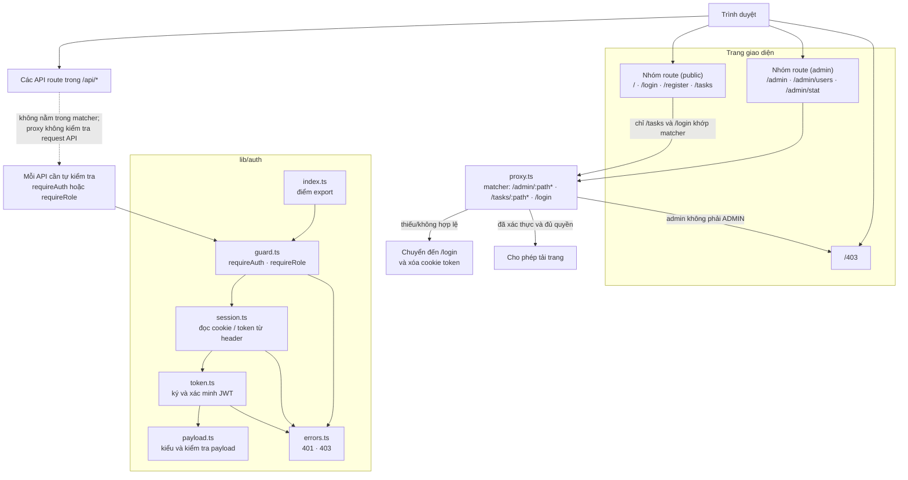
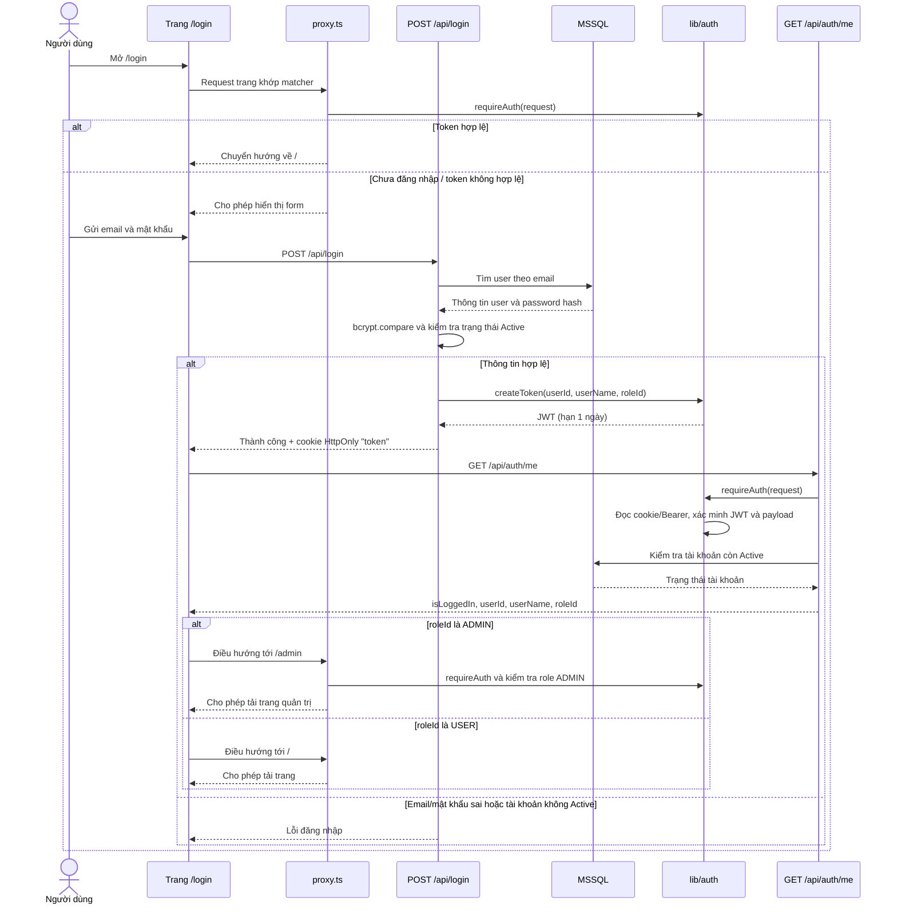

# Kiến trúc ứng dụng và luồng xác thực

Tài liệu này mô tả cấu trúc route hiện tại, các phần của module xác thực và cách request đi qua ứng dụng. Các route group trong ngoặc đơn, như `(public)` và `(admin)`, chỉ dùng để tổ chức mã nguồn; tên group không xuất hiện trong URL và không tự quyết định quyền truy cập.

## Sơ đồ tổng quan

> `app/(public)/tasks` vẫn phục vụ URL `/tasks`, và URL này có trong matcher nên bị `proxy.ts` yêu cầu đăng nhập. `(public)` là tên nhóm thư mục, không phải cam kết rằng mọi trang trong nhóm đều truy cập công khai.

## Luồng đăng nhập

`/api/login` xác thực thông tin đăng nhập rồi đặt cookie; trang đăng nhập tiếp tục gọi `/api/auth/me` để lấy role và chọn URL đích. `/api/auth/me` tự gọi `requireAuth` vì request API không đi qua matcher của proxy.

## Nhóm trang

| Nhóm mã nguồn | URL | Vai trò |
| --- | --- | --- |
| `app/(public)/` | `/` | Trang chủ |
| `app/(public)/login/` | `/login` | Form đăng nhập; proxy chuyển người đã đăng nhập về `/` |
| `app/(public)/register/` | `/register` | Form đăng ký; không nằm trong matcher |
| `app/(public)/tasks/` | `/tasks` | Giao diện công việc; proxy yêu cầu đăng nhập |
| `app/(admin)/admin/` | `/admin`, `/admin/users`, `/admin/stat` | Giao diện quản trị; proxy yêu cầu đăng nhập và role `ADMIN` |
| `app/403/` | `/403` | Trang báo không có quyền |

`app/(admin)/admin/layout.tsx` bố trí sidebar và header; kiểm tra quyền trang được thực hiện trong `proxy.ts`, không phải bởi tên route group.

## Module `lib/auth`

| Tệp | Trách nhiệm |
| --- | --- |
| `lib/auth/index.ts` | Export API chung của module |
| `lib/auth/guard.ts` | `requireAuth` xác thực request; `requireRole` kiểm tra role |
| `lib/auth/session.ts` | Đọc JWT từ cookie `token` hoặc header `Authorization` |
| `lib/auth/token.ts` | Ký JWT HS256 hết hạn sau một ngày; xác minh JWT và trả payload hợp lệ |
| `lib/auth/payload.ts` | Định nghĩa `AuthPayload` (`userId`, `userName`, `roleId`) và kiểm tra payload |
| `lib/auth/errors.ts` | Các lỗi xác thực `UnauthorizedError` (401) và `ForbiddenError` (403) |

`requireRole` trước hết gọi `requireAuth`, sau đó so sánh `roleId` với role được yêu cầu. Role hiện tại được định nghĩa tại `constants/roles.ts` (`USER = 1`, `ADMIN = 2`).

## API và yêu cầu tự bảo vệ

`proxy.ts` có matcher giới hạn ở `/admin/:path*`, `/tasks/:path*` và `/login`. Matcher này không bao gồm `/api/*`, nên request trực tiếp tới API không được lớp proxy xác thực hoặc phân quyền. Kiểm tra ở giao diện/trang cũng không bảo vệ API: client có thể gọi endpoint trực tiếp. Vì vậy, từng API có dữ liệu hoặc thao tác cần bảo vệ phải xác thực và phân quyền ngay trong handler trước khi truy cập dữ liệu.

| API | Kiểm tra trong handler | Ghi chú |
| --- | --- | --- |
| `POST /api/register` | Không yêu cầu đăng nhập | Tạo tài khoản với role `USER` |
| `POST /api/login` | Không yêu cầu đăng nhập | Kiểm tra thông tin đăng nhập, tạo JWT và đặt cookie |
| `POST /api/logout` | Không yêu cầu đăng nhập | Xóa cookie `token` |
| `GET /api/auth/me` | `requireAuth` | Trả thông tin đăng nhập và kiểm tra trạng thái tài khoản |
| `GET/POST /api/tasks` | `requireAuth` | Giới hạn dữ liệu công việc theo `userId` của JWT |
| `PATCH /api/tasks/[id]` | `requireAuth` | Chỉ cập nhật công việc thuộc `userId` của JWT |
| `GET /api/admin/users` | `requireRole(ADMIN)` | Danh sách người dùng |
| `PUT /api/admin/users` | `requireRole(ADMIN)` | Cập nhật thông tin người dùng |
| `PUT /api/admin/users/status` | `requireRole(ADMIN)` | Cập nhật trạng thái người dùng |
| `GET /api/admin/stat` | `requireRole(ADMIN)` | Thống kê quản trị |
| `PUT /api/admin/users/profile` | `requireRole(ADMIN)` | Cập nhật hồ sơ người dùng |
